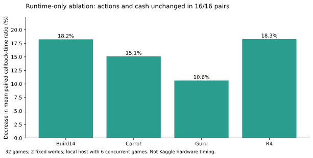

# 如何复核本项目的实验结果

本页定义指标、样本范围和公开数据的来源。公开 CLI 重算保存的精简结果，不重新运行完整比赛，也不重新生成全部回放审计。

## 核心指标

对每个候选／对照配对，固定初始 seed、对手和己方席位，分别运行完整比赛。

```text
candidate_margin = candidate_own_cash - candidate_rival_cash
control_margin   = control_own_cash   - control_rival_cash
margin_delta     = candidate_margin - control_margin
```

己方金币差、对手金币差和净差分别记录。平均值的单位为游戏金币，不是 Elo。

## R7最终组合板

网格为 2 世界 × 3 对手 × 2 席位 × 2 版本，共 24 局、12 个候选／对照配对。

| 对手 | 世界 | 席位 | 己方金币增量 | 对手金币增量 | 净差增量 | 对照健康 |
|---|---:|---|---:|---:|---:|---|
| Carrot | 1921601 | 0、1 各一对 | +3990 | +2902 | +1088 | 是 |
| Carrot | 1921605 | 0、1 各一对 | +3456 | +3052 | +404 | 否 |
| Build14 | 1921601 | 0、1 各一对 | +4333 | +3202 | +1131 | 是 |
| Build14 | 1921605 | 0、1 各一对 | +3548 | +2808 | +740 | 是 |
| Guru | 1921601 | 0、1 各一对 | +4672 | +2722 | +1950 | 是 |
| Guru | 1921605 | 0、1 各一对 | +3319 | +2866 | +453 | 是 |

公开 JSON 保存 12 行各自的原始终末现金和标记；表中合并显示数值一致的两个席位。完整 12 对平均净差 +961，12 正增、0 持平、0 下降。

两个世界此前已经暴露，且属于条件样本。双席和重复对手不是新增独立世界。该板支持最终组合在此条件下的观察结果，不支持总体胜率或无条件泛化结论。

## 严格健康检查与例外

全部 12 个候选局通过原健康检查。两处旧版 Carrot／R4／1921605 对照各保留一个累计 `input_application_errors=1` 标记。

两局仍完成 720 个状态、719 次回调，没有回调异常。相同累计标记在后续报告重复出现时，不计为多个独立错误。没有删除、重跑或将这些标记改成通过。

因此报告同时保留：

- 完整网格：12 配对，平均 +961；严格健康 22/24，门状态 FAIL
- 健康诊断子集：10 配对，平均 +1072.4；不替代完整结果

运行健康不等于生产义务全部无损。后续 R7 对照审计发现一处草莓漏末波的旧缺口；最终材料保留这个未解决问题。

## 现金审计

原完整回放审计按官方交易和雇工结算重建双方现金，最终 24 局 × 719 次，共 17,256 次转移的残差均为 0。

展示数据保留各局转移数、残差和原始回放身份。公开脚本只能汇总及校验这些保存字段；重新证明现金结算需要完整回放和冻结环境，二者未在此分发。

## 复制优化的独立对照

速度比较使用 R2-only normal32，不能用最终组合的不同工作量来推断复制优化速度。

- 网格：2 固定世界 × 4 对手 × 2 席位 × 2 版本，32 局、16 配对
- 双方动作、最终现金、模型选择、排除计时字段后的优化决策语义，16/16 一致
- 每对候选／对照总回调时间比的平均值：0.8443502058，降低 15.565%
- 排除首回调后的平均比值：0.8264384267，降低 17.356%
- 计时环境：本机六并发，未校准 Kaggle 硬件

平均配对时间比与汇总总耗时比是不同指标。公开代码从各配对耗时重算前者，不将两者混用。首回调未表现为加速。



两张图均由 `scripts/make_figures.py` 从公开 JSON 生成。需要重新生成时，安装 `scripts/requirements.txt` 中的可选绘图依赖，再运行该脚本。

## 机器学习证据

行为克隆的最佳已完成模型与数据对应关系见 [ML_EXPERIMENTS.md](ML_EXPERIMENTS.md)及 [ml_experiment.json](../data/ml_experiment.json)。

416 条训练轨迹对应 88.25% 开发验证指标；544 条训练轨迹属于另一个未完成合并实验。前者有 checkpoint，后者没有完成 checkpoint。开发验证集不作为封存测试集。

## 文件与身份

以下公开文件分别承担结果、来源和发布身份记录：

| 文件 | 内容 |
|---|---|
| [r7_cross24.json](../data/r7_cross24.json) | 全部配对终末现金、健康与审计摘要 |
| [r7_performance.json](../data/r7_performance.json) | 独立速度对照的配对耗时及一致性 |
| [provenance.json](../data/provenance.json) | 原始证据文件名与 SHA-256 |
| [ml_experiment.json](../data/ml_experiment.json) | 真实训练、开发验证及自主对局记录 |
| [experiment_decisions.json](../data/experiment_decisions.json) | 代表性保留／淘汰决定 |
| [release_identity.json](../data/release_identity.json) | 最终源码、包和 Kaggle 回执身份 |
| [checksums.json](../checksums.json) | 展示仓库精选文件的内容哈希 |

原始证据哈希标识导出来源，不能单独证明未公开的回放内容。公开副本经过精简和路径脱敏，拥有自己的哈希；二者在记录中区分。

## 复核方式与局限

运行标准库 CLI 和单元测试可复核统计及状态复制边界。可选 ML smoke 只检查当前模型接口。

最终成绩与排名等待官方发布。本报告没有自动查分、估计 Private 分数或将队友经验分数写成个人成绩。
