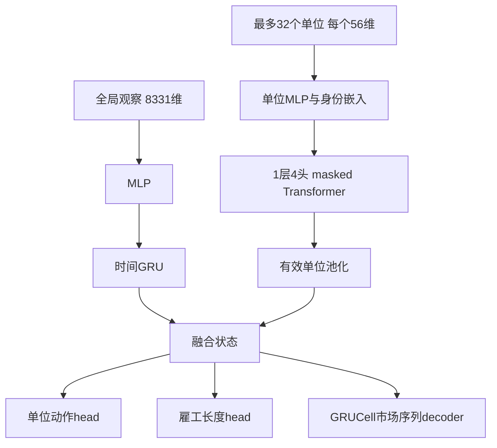

# 机器学习实践：完整动作行为克隆与闭环评估

项目实际训练过独立神经策略，用老师轨迹学习完整动作。最佳已完成实验在开发验证集上达到 88.25% 的完整动作一致率，但自主对局仍然失败。这一节说明数据、模型、训练和评估差异；该学生未进入最终 R7 参赛版本。

## 数据集与划分

本文的 88.25% 对应 `data_bulk_all` 与 `train_bulk_all2`，老师为 farm2945 策略。

| 数据 | 轨迹数 | 世界数 | 回合样本数 |
|---|---:|---:|---:|
| 训练集 | 416 | 208 | 299,104 |
| 验证集 | 32 | 16 | 23,008 |

原 manifest 中训练与验证的世界种子、轨迹 ID 没有交集。同一个世界的相反席位仍有相关性，不能当作完全独立样本。验证集用于开发和模型选择；记录标明没有封存测试集，因此这些指标不称最终测试成绩。

后续还有 `data_all_teachers` 的 544 条训练轨迹、391,136 个样本。其对应合并训练中断于 7/16 epoch，未生成完成 checkpoint。不能把这组数据量与最佳模型的 88.25% 连接成同一个成果。

## 输入与输出表示

模型将全局经营状态和各执行单位分别编码，处理单位动作与有顺序的市场订单。

- 全局观察为 8,331 维，包含时间、公开双方农场、市场、己方私有库存和观察变化量
- 最多 32 个执行单位，每单位 56 维特征
- 单位输出包括动作命令；另有雇工动作长度预测
- 市场输出使用商品／数量等动作词表和结束符表达订单序列

数据编码只使用策略允许读取的信息。教师完整代码、原始回放和权重不包含在公开示例中。

## 模型结构

全局状态通过多层感知机（MLP）和门控循环单元（GRU）形成时间表示，执行单位通过共享编码器和带掩码的 Transformer 交互。



市场序列训练使用教师强制（teacher forcing）；验证完整动作一致率使用自由解码。模型存在可选价值输出，但本次行为克隆实验没有训练强化学习目标。

## 已完成训练配置

最佳已完成实验训练 20 个 epoch，以验证损失选择第 4 个 epoch 的 checkpoint。

| 配置 | 记录值 |
|---|---|
| 隐藏维度 | 192 |
| Batch size | 2 |
| 截断反向传播长度 | 32 |
| 优化器 | AdamW |
| 学习率／权重衰减 | 3e-5／1e-5 |
| 梯度裁剪 | 1 |
| 非 PASS 单位动作权重 | 2 |
| 雇工长度损失权重 | 0.2 |
| 类别频率平衡 | 本次未启用 |
| 记录中的训练设备 | RTX 4060 Laptop GPU |

损失由单位动作交叉熵、市场序列交叉熵和 0.2 倍雇工长度交叉熵组成，并处理掩码及 PAD／UNK 标签。完整实现见公开的[模型快照](../ml/replay_learning/full_action_model_v73.py)。

## 离线指标与自主对局

离线指标衡量模仿老师的程度；完整对局衡量策略离开老师轨迹之后是否还能赚钱。

| 评估 | 结果 |
|---|---|
| 完整动作 exact | 20,305 / 23,008 = **88.2519%** |
| 活跃单位动作准确率 | 99.4038% |
| 完整市场订单 exact | 90.7684% |
| 自主对 Master | 3 世界 × 双席，**0 胜 6 负** |
| 自主金币均值 | 89,628.83 |
| 自主净金币差均值 | −15,661.67 |
| 评测时教师接管 | 0 |

结果文件见 [ml_experiment.json](../data/ml_experiment.json)，其中保留原始证据文件的 SHA-256。上述数据足以说明这个学生尚未达到本次部署标准，不能据此推断所有行为克隆方法无效。

可能的失败机制包括错误累积后的状态分布变化、市场订单编码难度和少量关键动作错误。这些是针对负结果的分析假设；本项目没有完成能逐项隔离它们的因果实验。

## 本次公开代码能做什么

公开目录保留当前自有模型及 schema 的可读快照，并提供合成输入示例。

```bash
python -m pip install -r ml/requirements.txt
python ml/smoke.py
```

示例在 CPU 上检查前向计算、自由解码、损失和一次反向传播。合成输入不构成比赛数据，也不会复现历史 88.25% 结果。

当前特征 schema 与历史 manifest 对应，但数据 builder 后续已变化。完整历史训练数据、教师策略和权重未在此公开，因此不能承诺从展示仓库一键重现历史训练。复核配对结果的标准库命令与该可选模型示例相互独立。

## 对最终方案的影响

这段训练实践促使我把评估从动作一致率延伸到自主完整对局，并明确区别预测模型、神经策略和最终执行系统。

最终 R7 使用团队规则／行为影子模型与有限搜索，早期神经学生没有进入比赛版本。强化学习路线未完成训练。简历可展示已完成的行为克隆、数据划分和闭环评估实践，并清楚交代部署结果。
